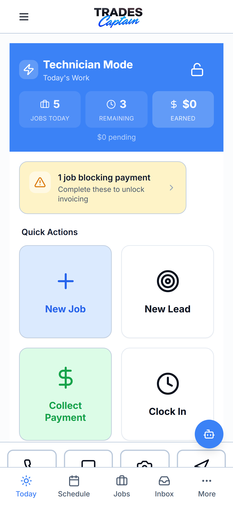

# Trades Captain CRM

Trades Captain CRM is a mobile-first customer relationship management project for HVAC, plumbing, electrical, and other trade service businesses. It brings customer records, lead pipelines, job scheduling and dispatch, quotes, invoices, and a customer portal into a Next.js application. The repository includes payment, messaging, voice, and calendar integration code; the [feature summary](FEATURES.md) describes the implemented modules, while the verification reports below distinguish tested behavior from unverified integrations.

## Screenshots



These are historical development captures, not a current acceptance-test result. [Browse the existing captures](public/screenshots-preview/). `npm run screenshots` writes new captures to that same directory after a local server and isolated demo account are configured. Some older captures contain incomplete data or development errors; inspect generated images before presenting them.

## Tech stack

Next.js 16 · React 19 · TypeScript · Tailwind CSS · Supabase · Stripe · Capacitor · Jest · Stryker · k6 · Sentry

## Architecture

- **App Router:** route groups separate authentication, CRM dashboard, admin, onboarding, and marketing views; API handlers live under `app/api/`.
- **Supabase:** authenticated browser/server clients, database types, and versioned schema migrations support persistence and access control.
- **Stripe:** billing, payment links, subscriptions, and webhook handlers support payment workflows; the remaining test failures are documented below.
- **Admin and customer portals:** admin views use their own authentication layer, while business-scoped customer pages live under `app/portal/`.
- **Mobile:** responsive technician views, offline-support modules, and Capacitor configuration provide the mobile foundation; native builds are not verified by the web build.

## Getting started

Use Node.js 20.9 or newer and npm 10 or newer.

```sh
npm ci --legacy-peer-deps
cp .env.example .env.local
```

On PowerShell, use `Copy-Item .env.example .env.local` for the copy step. The template is intentionally blank. Fill it with your own isolated development configuration; never paste real credentials into tracked files.

At minimum, configure your Supabase URL and anon key, the server-only service-role credential, and the application security settings required by the modules you intend to run. Use test/sandbox configuration for optional integrations. Review the schema and migration history in [`supabase/migrations/`](supabase/migrations/) before applying it to your own project; historical migrations include duplicate version prefixes and must not be applied blindly to production.

```sh
npm run dev
```

Open [the local login](http://localhost:3000/login). Customer portal URLs use `/portal/<business-id>/login`; `npm run dev:portal` runs portal development on port 3001. [Manual SQL scripts](scripts/sql/) are separate from migrations and require review before use.

### Regenerating screenshots

Use a separate demo project and account. Set `DEMO_EMAIL` and `DEMO_PASSWORD` locally. The screenshot script uses those credentials rather than a committed password.

```sh
npx playwright install chromium
node --env-file=.env.local scripts/capture_screenshots.js
```

The optional demo seed command resets deterministic demo records. Review it before use and supply its Supabase and demo settings through the environment. Do not run it against production. No demo seed or live integration script was run during this repository cleanup.

## Tests and CI

```sh
npm run lint
npm run type-check
npm test -- --runInBand
npm run build
npm run test:coverage:gate
npm run test:mutate
npm run perf:test
```

The last two commands are separate mutation/load-testing workflows; load tests need an explicitly chosen test target. [CI](.github/workflows/ci.yml) configures lint, TypeScript, Jest, a coverage gate, nightly mutation tests, and `npm audit`. [Deployment](.github/workflows/deploy.yml) requires externally configured credentials. The cleanup did not upgrade dependencies, weaken checks, or deploy the application.

## Status and known gaps

See [test results](docs/test-results-report.md) and [production-readiness review](docs/PRODUCTION-READINESS.md) for dated before/after results. A successful web build is not a production-readiness certification. Remaining failing tests, lint warnings, integration configuration, native builds, and an authenticated walkthrough must be resolved or verified before a release.

Historical credentials require rotation. The [security review](docs/security/README.md) records redacted findings and the pending history-purge plan. Current-tree sanitization does not revoke exposed keys or remove them from Git history. No history rewriting or force push was performed.

## Contributing and license

See [CONTRIBUTING.md](CONTRIBUTING.md). Original project code is available under the [MIT License](LICENSE); third-party components retain their own licenses.
